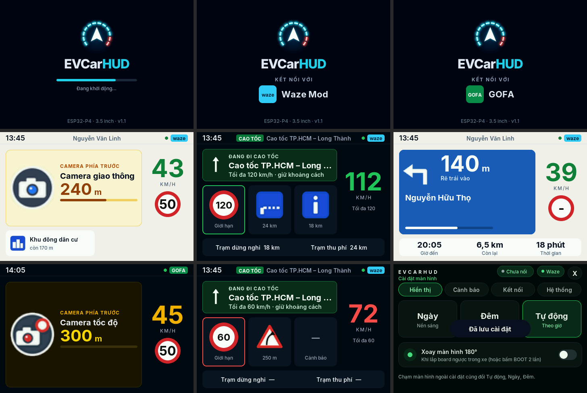

# EVCarHUD cho board ESP32-P4 3.5" (Waveshare ESP32-P4-WIFI6-Touch-LCD-3.5)

Firmware HUD cho board **Waveshare ESP32-P4-WIFI6-Touch-LCD-3.5** (ESP32-P4 + ESP32-C6, màn 3.5" ST7796 480×320 đặt ngang, cảm ứng điện dung FT6336, loa ES8311).
Cùng chức năng với bản 2.8" ([EVCarHUD_S3](https://github.com/chutich3344/EVCarHUD_S3)): điện thoại chạy **Waze Mod** (giao thức HLP/1) hoặc app **GOFA** gửi dữ liệu dẫn đường qua **Bluetooth LE**, HUD giải mã và hiện giao diện. Giao diện vẽ lại cho màn 3.5" theo bộ màn mẫu "Layout HUD ESP32-P4 3.5 inch", mọi con số dùng font Inter. Thanh trên của các màn chạy xe có ô nguồn **waze** / **GOFA** cạnh chấm GPS.



Để khỏi nhầm với bản 2.8", board này quảng bá Bluetooth tên **EVHUD-P4** (bản 2.8" là "EVCarHUD") và báo model **EVCarHUD 3.5** cho app GOFA.

## Các màn hình

HUD tự chọn màn theo dữ liệu từ điện thoại:

| Màn | Khi nào | Nội dung |
|---|---|---|
| **Khởi động** | Vừa bật nguồn (3 giây) | Logo EVCarHUD, thanh tiến trình "Đang khởi động…", rồi "KẾT NỐI VỚI" + ô **waze** (xanh nhạt) hoặc **GOFA** (xanh lá) theo nguồn đang chọn |
| **Đã kết nối** | Điện thoại vừa kết nối | Như màn trên kèm "Đã kết nối điện thoại", hiện 2,5 giây (chạm để tắt) |
| **Màn chờ** | Chưa có dữ liệu, hoặc đứng yên 30 giây khi không dẫn đường | Chưa nối điện thoại: đồng hồ số 24 giờ (dấu ":" nhấp nháy). Đã nối: đồng hồ lật. Ngày tháng, trạng thái kết nối |
| **Tốc độ** | Đang chạy, chưa đặt lộ trình | Số tốc độ rất to: xanh, vàng khi cách giới hạn ≤ 5 km/h, đỏ khi vượt. Biển giới hạn to, biển báo trên đường, dải dưới báo vượt tốc độ / cảnh báo xa / "Đường thoáng" |
| **Cảnh báo** | Đang chạy, có cảnh báo trong 800 m (camera, cảnh sát, tai nạn, nguy hiểm...) | Thẻ vàng: biển cảnh báo to, tên, khoảng cách, thanh ngắn dần. Hai ô phụ cho cảnh báo / biển tiếp theo |
| **Cao tốc** | Đang chạy, giới hạn ≥ 80 km/h hoặc tên đường có "Cao tốc" | Thẻ xanh lá tên cao tốc, ô giới hạn / biển báo / cảnh báo, trạm dừng nghỉ và trạm thu phí phía trước |
| **Chỉ dẫn** | Đang dẫn đường | Thẻ xanh dương: mũi tên rẽ, khoảng cách, kiểu rẽ, tên đường, lượt rẽ tiếp theo. Giờ đến, quãng đường còn lại, thời gian. Có cảnh báo thì dải dưới chuyển thành dải vàng |
| **Cài đặt** | Giữ tay trên màn hình 5 giây, hoặc giữ BOOT 1–5 giây rồi thả | Nền tối, màu chủ đạo xanh lá. 4 trang: **Hiển thị** (Ngày / Đêm / Tự động, xoay 180°), **Cảnh báo** (bật/tắt loa, âm lượng), **Kết nối** (chọn Waze Mod / GOFA, MAC Bluetooth), **Hệ thống** |

Vượt tốc độ: số đỏ, viền đỏ nhấp nháy, loa kêu 2 tiếng (nhắc lại mỗi 8 giây). Cảnh báo mới và còn 100 m tới chỗ rẽ: 1 tiếng.

Thao tác (giống bản 2.8"):
- **Chạm màn hình** hoặc **bấm BOOT 1 lần**: đổi Tự động → Ngày → Đêm (Tự động: 6:00–18:00 là ngày, theo giờ điện thoại).
- **Bấm BOOT 2 lần**: xoay màn hình 180° (board nhớ cho lần sau).
- **Giữ BOOT 5 giây**: bật/tắt chế độ trình diễn (dữ liệu giả, không cần điện thoại).
- Trong cài đặt: chạm trực tiếp, hoặc bấm BOOT 1 lần = mục kế, 2 lần = chọn.

## 1. Build

Cài **ESP-IDF 5.5** (bộ cài Windows: https://dl.espressif.com/dl/esp-idf/). Mở **ESP-IDF 5.5 PowerShell**:

```bat
cd H:\Projects\EVCarHUD_P4
idf.py set-target esp32p4
idf.py build
```

Lần đầu `idf.py` tự tải LVGL, driver ST7796 / FT5x06, esp_hosted (cầu nối tới chip C6) và esp_codec_dev (cần mạng).

**Không cài ESP-IDF cũng được**: mỗi lần đẩy code lên nhánh `main`, GitHub tự build (mục **Actions → Build firmware**) và đặt file `evcarhud-3.5-<commit>.bin` vào bản phát hành **ban-moi-nhat**.

## 2. Nạp

Cáp USB-C **dữ liệu** nối máy tính với cổng **USB TO UART** của board:

```bat
idf.py -p COM5 flash monitor
```

Nạp không được: giữ **BOOT**, bấm **RST**, thả BOOT, chạy lại. Hoặc gộp thành 1 file (nạp ở địa chỉ **0x0**): `idf.py merge-bin -o evcarhud-full.bin`.

Nạp file .bin có sẵn bằng **ESP Flash Download Tool** (chọn ESP32-P4) hoặc esptool:

```bat
python -m esptool --chip esp32p4 -p COM5 -b 460800 write_flash 0x0 evcarhud-p4-full.bin
```

File `evcarhud-p4-full.bin` gồm bootloader + bảng phân vùng + firmware, nạp ở **0x0**. Chỉ nạp phần firmware (board đã có bootloader) thì nạp `evcarhud_p4.bin` ở **0x10000**.

## 3. Lần chạy đầu

Màn hình hiện 1,5 giây 4 ô: **ĐỎ** (trên trái), **XANH LÁ** (trên phải), **TRẮNG** (dưới trái), **XANH DƯƠNG** (dưới phải), rồi logo và màn chờ; loa kêu "tít" một tiếng là loa chạy.
Nếu sai, mở `idf.py menuconfig` → **EVCarHUD → Man hinh**:

| Hiện tượng | Sửa |
|---|---|
| Đỏ và xanh dương đổi chỗ | Bật/tắt **Thu tu mau BGR** |
| Màu như ảnh âm bản | Bật/tắt **Dao mau** |
| Hình bị lật ngang / dọc | Bật/tắt **Lat ngang** / **Lat doc** (rồi chỉnh **Cam ung FT6336** cho khớp) |
| Hình nhiễu | Giảm **Toc do SPI** |
| Không cần màn kiểm tra nữa | Tắt **Man kiem tra mau** |

## 4. Kết nối điện thoại

- **Waze Mod**: **Waze Mod → HUD → Bluetooth LE**, chọn thiết bị **EVHUD-P4**.
- **GOFA**: vào Cài đặt → **Kết nối** → chọn GOFA, chép **MAC Bluetooth** để đăng ký trên GOFA, bấm **RST**. Ở chế độ GOFA board quảng bá tên `HUD_xxxx`.

Bluetooth của board nằm ở chip **ESP32-C6** (nối với P4 qua SDIO); ngăn xếp NimBLE chạy trên P4. C6 không có Bluetooth Classic nên chỉ dùng BLE. Firmware C6 xuất xưởng không trả lời lệnh bật Bluetooth của esp_hosted 3.x nhưng đã tự bật sẵn, nên mặc định firmware nối thẳng kênh HCI (`menuconfig → EVCarHUD → C6 dung firmware xuat xuong`). Cập nhật firmware C6 lên esp_hosted 3.x thì tắt mục đó.

## Chân GPIO (theo sơ đồ board)

| Phần | Chân |
|---|---|
| LCD ST7796 (SPI) | MOSI 20, SCLK 21, CS 23, DC 26, RST 27, đèn nền 28 |
| Cảm ứng FT6336 (I2C 0x38) | SDA 7, SCL 8, RST 29, INT 50 |
| Loa: codec ES8311 (I2C 0x18) + I2S | MCLK 13, BCLK 12, WS 10, DOUT 9, bật loa 53 |
| Nút BOOT | 35 |

## Cho người phát triển

- `main/dashboard.c`: giao diện 480×320 (LVGL 9), chỉ nhận dữ liệu qua các hàm `ui_set_*` (cùng API với bản 2.8").
- `main/dashboard_hlp.c`, `main/hlp.c`: giải mã HLP/1 của Waze Mod. `main/gofa.c`: giải mã bản tin GOFA. `main/ble_link.c`: Bluetooth LE (NimBLE qua esp_hosted). Các file này giống bản 2.8".
- `main/board.c`: màn hình, cảm ứng, đèn nền. `main/audio.c`: loa ES8311.
- `tools/pc_preview/build.sh`: chụp ảnh giao diện trên PC (Linux/WSL), không cần board.
- `tools/fonts/gen_fonts.sh`: tạo lại font (Inter, JetBrains Mono) – cần Node.js.
